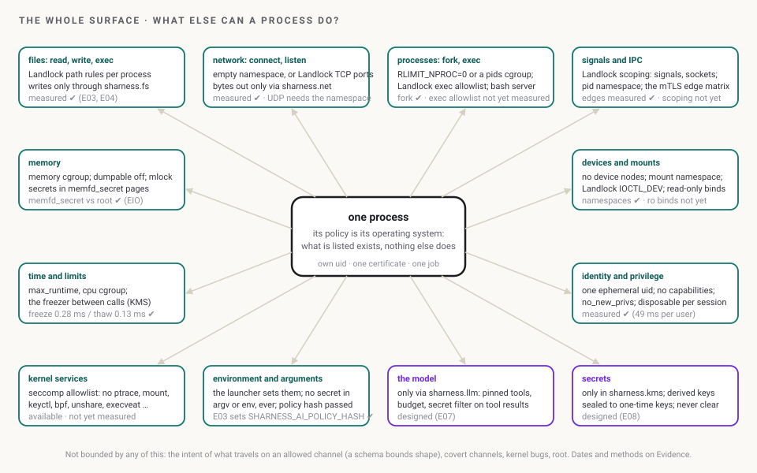

# The brief: SHarness in one read

> **Status: design, with the first experiments runnable.** This is the one page to read first: what SHarness is, the moving parts and how they work together, one request end to end, what binds a process, the spectrum from a hello world to sgit, where it is now and what to decide. Everything on it is drawn from the design pages, as of 24 Oct 2026; the design pages hold the detail and the evidence. By sharness.build for Dinis Cruz.

## 1. What it is, in three sentences

SHarness runs an agent and its tools as a few small, single-purpose processes, each locked down by the kernel and talking to the others only over allowed, mutually authenticated connections. A secret lives in one place, the KMS, which never hands out a clear key; a tricked process can only do its one job. The person, not the agent, supplies the hash of the policy that says what each process may do, so a prompt injection cannot widen it.

It started on 24 October 2026 as a fix for one gap in sgit: a vault key sealed while it travelled and exposed the moment it arrived, on disk, on the command line and in the agent's transcript ([Why](why/index.md)). Nothing in the fix was specific to sgit.

## 2. The moving parts

*The moving parts. Every box is a process with its own uid, Landlock ruleset, seccomp filter, namespaces, cgroup and one certificate. Every arrow is a mutual TLS connection whose two roles must be in the edge list. Designed, not built.*

| Part | Its one job | Holds | May talk to |
|---|---|---|---|
| **the person** | supplies the policy hash `sha256:M` out of band; carries sealed QR codes | nothing the agent can read | the launcher |
| `sharness.launcher` | refuses unless the manifest hashes to M; makes uids, a session CA, one certificate per role; destroys the CA key; starts, freezes and stops the components | the manifest; no secrets | everything, once, at start |
| **the harnessed app / orchestrator** | sgit's CLI, a Claude Code session, your own loop: parses, routes, renders | no keys; it sees file contents | fs, net, bash, llm; **never** kms |
| `sharness.fs` | the only writer of protected folders; refuses anything that parses as a clear key, a private key or a token | no keys | nobody; it answers the app |
| `sharness.net` | the only network client and the TLS client: host, endpoint and vault-id allowlists | derived keys for one command, in a secret page | kms; the outside world |
| `sharness.bash` | runs each shell command in a fresh sandbox under a profile; filters its output | nothing | net, if the profile allows |
| `sharness.llm` | the only client of the model API; pins the tool list; filters secrets out of every tool result; adds the real key | the real API key, obtained sealed | kms; the model API |
| `sharness.kms` | opens sealed things, derives what the caller needs, re-seals it to a one-time key | the private keys, in a `memfd_secret` page, frozen between calls | net and llm only; no files, no network |
| `sharness.policy` | not a process: the manifest, its layers, its hash | | |

The edge matrix (who may call whom, deny by default) is on [Architecture](architecture/index.md#edges-deny-by-default) and as a [clickable mockup](../explain/mockups/edges.html). Each part in detail is on [Components](components/index.md).

## 3. One request, end to end

*`sgit clone --sealed`, through the parts. The KMS is thawed for one answer and frozen again. The transcript sees the command, ciphertext, fingerprints and progress.*

Every later command (`status`, `pull`, `push`) repeats steps 3 to 5 with a new one-time key and a new nonce. A read-only command asks with `op=read` and the KMS returns only the read key, so `sharness.net` cannot push even if told to. A `push` needs `op=write`, which policy may bind to a fresh approval from the person. The protocol, with every check the KMS makes, is on [Keys and the KMS](keys/index.md#3-the-kms-protocol).

## 4. What binds a process: the whole surface

Ask what a process can do at all, and the list is short: files, network, other processes, signals and IPC, memory, time, devices, its identity and privileges, kernel services, its environment and arguments, and, for an agent, the model and secrets. SHarness puts a bound on each one, in the kernel where the kernel can and in a separate component where it cannot. What is left when everything else is limited is the process's own policy: in effect, a small operating system that contains exactly what the policy lists and nothing else.

*The whole surface. Green boxes are kernel bounds; purple ones are components. The grey line in each says whether it was measured yet.*

The full map, with what each bound does not cover, is [What a process can do](surface/index.md).

## 5. From a hello world to sgit

The same components, with more of them switched on, cover everything from one child process to a harness-aware application:

*Five profiles. P0 is runnable today (`sharness-ai hello`); the rest are designed. Only P4, sgit, needs code changes, and only where it handles keys.*

The profiles, the policy each needs, and the map of how sgit's next version stays compatible are on [the spectrum](spectrum/index.md).

## 6. Where it is now

| Rung | What | Status as of 24 Oct 2026 |
|---|---|---|
| browser | the [policy hash](../explain/mockups/policy-hash.html) and [edge matrix](../explain/mockups/edges.html) mockups; three [storyboards](../explain/storyboards/index.md) | published |
| any session | E01 `probe` (the grant), E02 `policy hash` (the one value the person supplies) | runnable |
| Linux | E03 `run` (one command under a policy, Landlock), E04 `hello` (the acceptance test for one child process) | runnable; E04 measured, 5 of 5 held |
| planned | E05 the edges as a script, E06 the process tree, E07 `sharness.llm` v0, E08 `sharness.kms` v0 | in the order on the [research note](../evidence/research/index.md#4-what-is-still-open-in-the-order-to-take-it) |
| designed | the components under one manifest hash; the launcher above the agent; the platform | the design pages |

No component is built. The whole ladder is on [Mockups and experiments](../code/experiments/index.md); the measurements on [Evidence](../evidence/index.md).

## 7. What there is to decide

1. **Who runs the launcher.** The agent itself (every lock is then a Setting for the agent), a script above it on a laptop (a Boundary), or the platform (a Boundary all the way down). The design wants the third and starts with the second. [Roadmap decision 5](roadmap/index.md#open-decisions).
2. **Claude Code's own sandbox as a layer.** It already does for Bash what `sharness.bash` would; should a policy generate its settings rather than compete? [Decision 9](roadmap/index.md#open-decisions).
3. **Full split or step 1 in sgit.** Whether `sharness.net` does all vault crypto (the target) or first just filters traffic. [Decision 2](roadmap/index.md#open-decisions).
4. **The order of E05 to E08**, and whether `sharness.kms` v0 comes before `sharness.llm` v0 (the gateway needs the key the KMS holds). [Decision 10](roadmap/index.md#open-decisions).

## 8. Reading order after this page

[Why](why/index.md) → [Architecture](architecture/index.md) → [Components](components/index.md) → [Keys and the KMS](keys/index.md) → [Process Behaviour Policies](policies/index.md) → [Agents and LLMs](agents/index.md) → [Enforcing the process tree](process-tree/index.md) → [Evidence](../evidence/index.md) → [Roadmap](roadmap/index.md). Then [What a process can do](surface/index.md), [the spectrum](spectrum/index.md), [Mockups and experiments](../code/experiments/index.md), the [research note](../evidence/research/index.md) and the [market analysis](../landscape/market/index.md). The source pack is verbatim under [the source documents](../project/sources/index.md).
