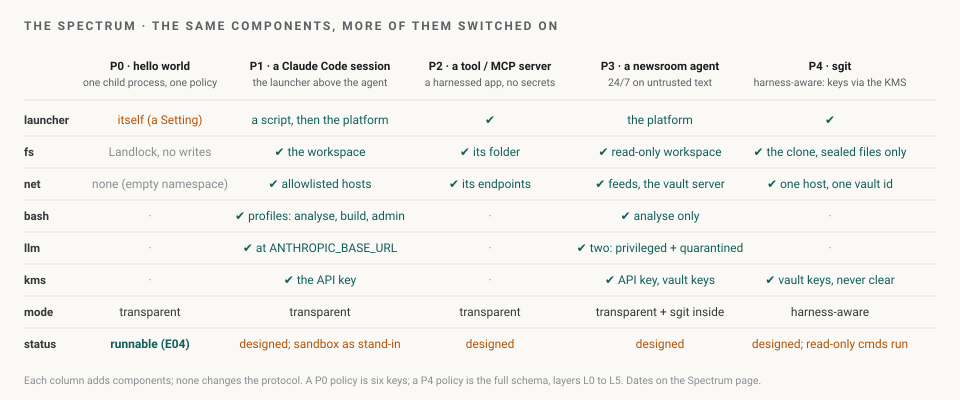

# From a hello world to sgit: the spectrum

> **Status: design, with P0 runnable and two sgit rows measured.** SHarness has to protect the simplest case, a hello world, as well as a Claude Code session, a tool, an agent that runs all day on untrusted text, and a complex application like sgit. This page lays those out as five profiles of one harness, says what each needs, and maps how sgit's next version stays compatible. Measured rows are as of 24 Oct 2026.

*The same components, more of them switched on. No profile changes the protocol; each adds a policy layer.*

## 1. The five profiles

| | P0 · a hello world | P1 · a Claude Code session | P2 · a tool or MCP server | P3 · a newsroom agent | P4 · sgit |
|---|---|---|---|---|---|
| **What runs** | one child process (`python -c`, `curl`, a script) | the orchestrator: Claude Code, the Agent SDK, your own loop | one program that answers requests: an MCP server, a fetcher, a converter | an agent loop that reads feeds, pages and documents around the clock | an application that holds secrets: vault keys, tokens, signing keys |
| **Threat** | it writes where it should not, or phones home | prompt injection drives the tools; the API key sits in the harness | a crafted input exploits its parser; it exfiltrates what it was given | untrusted text acts through the agent, all day, unattended | the key leaks to disk, argv, the transcript; a confused deputy pushes elsewhere |
| **Policy** | v0: files read, write and exec; network none or ports; `no_new_privs` | L0 to L3 for the orchestrator: an execute allowlist (node, rg, the bash client), its state folder writable, the llm and bash ports only | L2 and L3 for the app: its folder, its endpoints, no exec | P1 plus: the workspace read-only, feed hosts allowlisted, `bash` profile `analyse` only, writes only through `sharness.fs` to one folder | L0 to L5, per subcommand: `status` gets `op=read` and no write key; `clone` gets one host and one writable folder |
| **Components** | the kernel only | launcher, bash, llm, kms (for the API key), net, fs | launcher, fs, net | launcher, fs, net, bash, two `sharness.llm` policies (privileged and quarantined), kms | launcher, fs, net, kms |
| **Mode** | transparent | transparent: `ANTHROPIC_BASE_URL`, `HTTPS_PROXY`, Bash denied and `sharness.bash` as the only shell, a one-line hook | transparent: a folder and a proxy | transparent, with sgit inside as the one harness-aware app | harness-aware where it handles keys; transparent everywhere else |
| **Who runs the launcher** | the process itself: a Setting, not a Boundary | a script above the agent on a laptop; the platform in the end state | the platform or a script | the platform | a script or the platform |
| **Status** | **runnable**: `sharness-ai hello`, measured 5 of 5 | designed; Claude Code's own sandbox is the stand-in for `sharness.bash` today | designed | designed; the newsroom's agents are the use case, not yet a user | designed; **read-only commands already run under a v0 policy** (§3) |

Two things hold across the row. First, the policy for a harder profile is the policy for an easier one plus a layer: P1 is P0 applied to the orchestrator with four ports allowed; P3 is P1 with the workspace read-only and a second model policy. Second, the components do not change between profiles; they are switched on. That is what makes one CLI project for all of them the right shape for now ([roadmap decision 7](../roadmap/index.md#open-decisions)).

## 2. The simplest cases first

**P0 today.** `sharness-ai hello` builds a deny-all policy for the running interpreter, runs probes under it and reports: read allowed, writes refused, a TCP connect refused, a wrong hash runs nothing. It is the memo's acceptance test for one process and the first rung of the [ladder](../experiments/index.md). The caveat it prints is the gap to P1: a process that applies a policy to its children does not bind itself.

**P1, the first step that binds the agent.** A script on a laptop starts Claude Code *under* a Landlock domain and a non-root uid, with `ANTHROPIC_BASE_URL` pointing at `sharness.llm` and the built-in Bash tool removed by a bare `Bash` deny rule, so `sharness.bash` as an MCP server is the only shell. The orchestrator can execute only `node`, `rg` and the bash client; it can write only its own state folder; it can connect only to the llm and bash ports. Every side door is on [Enforcing the process tree](../process-tree/index.md), and E06 is the experiment that tests them. Until then, Claude Code's own sandbox (bubblewrap, a network namespace, a hostname proxy) is the stand-in for `sharness.bash`, and a policy should be able to generate its settings ([decision 9](../roadmap/index.md#open-decisions)).

**P2 and P3** need nothing P1 does not, except the dual-LLM split for P3: the model that reads the feed has no tools and a strict output schema; the model that plans never sees the feed. Both are two `sharness.llm` policies on [Agents §5](../agents/index.md#5-untrusted-text-two-models-two-components). P3 is where the newsroom's agents land, and their file and network behaviour policies written down are the first real test of the schema ([research note §4](../research/index.md#4-what-is-still-open-in-the-order-to-take-it)).

## 3. sgit's next version: the compatibility map

sgit 0.24.0 reads the vault key in many places (the origin article counts 27 sites in 17 files). The design's rule is that an app needs harness awareness only where it handles secrets or where a policy must understand its protocol; everything else is transparent. So the map has two halves: what already works unchanged, and what changes, in steps that each leave sgit working exactly as before when nothing is switched on (the sgit pack's own compatibility document: *with nothing switched on, sgit behaves as 0.24.0 does; sealed and plain clones side by side; a staged rollout*).

### What runs unchanged today, measured

On 24 Oct 2026, sgit 0.24.0 as installed from PyPI, under a v0 policy allowing the system and the key store read-only, no writes and no network (`sharness-ai run`, in one Claude agent workspace, as of 24 Oct 2026):

| Command | Result |
|---|---|
| `sgit --version` | runs, prints `sgit-ai v0.24.0` |
| `sgit pki list` | runs, prints `No key pairs found.` |
| `sgit pki keygen` | reaches the passphrase prompt (interactive; not completed in the probe) |
| any command that writes to the clone or reaches the vault server | would be refused by the policy as written; a P4 policy adds one writable folder and port 443 |

Method: `sharness-ai run --policy p.json -- sgit …` with `files.read` of `/usr`, `/lib`, `/lib64`, `/bin`, `/etc` and `~/.sg-send`, `files.write` empty, `network: "none"`. `sgit --version` made 36 distinct syscalls under `strace -c` (the design's `strace -f` count was 38). This is the transparent mode working for the commands that need no key and no network: nothing in sgit changed.

### What changes, in steps

| Step | Change in sgit | Compatible because | Policy it enables |
|---|---|---|---|
| 0 | Fix two weaknesses whatever else happens: private keys from `pki keygen` move from PBKDF2 at 2,048 iterations to Argon2id; `Secrets__Store`'s fixed salt becomes per-user random | no interface changes | |
| 1 | **The door**: one `Key_Source` interface ("vault id and derived keys for this folder"), reading `vault_key` today; every call site goes through it; lazy imports per subcommand | no behaviour change; the tests prove it; a smaller footprint shrinks the policy (`--version` opens 1,104 files today) | per-subcommand L4 policies become small enough to write |
| 2 | `Key_Source` backed by the KMS protocol: `clone --sealed`, `vault_key.sealed`, `vault seal-local`, `vault seal --to`; plain keys refused on argv when `SHARNESS_AI_POLICY_HASH` is set; `show-key` refused on a sealed clone | a plain clone still works as 0.24.0 does; sealed and plain clones side by side; conversion is one command that verifies before it deletes | the key never on disk, argv or stdout; `sharness.net` filters traffic |
| 3 | **The full split**: vault crypto and server I/O move into `sharness.net`; the app asks for operations, not keys | the app's commands and output do not change; only where the work happens | the app holds no keys and has no network at all |
| 4 | `sharness.fs` as the only writer; later, optionally, a FUSE mount | the clone folder looks the same to every tool | business rules on disk enforced outside the app |
| 5 | the P-256 ECDH envelope for hardware keys; commit signing with the session identity | additive | hardware-backed KMS |

How sgit detects it is inside the harness: the environment the launcher (or today, `sharness-ai run`) sets, `SHARNESS_AI_POLICY_HASH` and `SHARNESS_AI_POLICY_ID`, plus the `identity` file in `.sg_vault/local/` naming the KMS endpoint. With neither present, sgit is 0.24.0. The per-command flows for steps 2 and 3 are drawn on [Keys and the KMS §4](../keys/index.md#4-command-flows-sgit-inside-the-harness); the full refactor path is on the [Roadmap](../roadmap/index.md#refactor-path-in-sgit).

## 4. What this page does not claim

- Only P0 is runnable; P1 to P4 are designs, and the sgit rows measured are the two commands that need no key and no network.
- The newsroom's agents are a use case, not a user; their policies are not yet written.
- The steps for sgit are a plan from the design pack, not a commitment of sgit's maintainers, and nothing in sgit has changed yet.

Sources: [Components](../components/index.md) (transparent vs harness-aware); [Agents and LLMs](../agents/index.md) §2 and §5; [Enforcing the process tree](../process-tree/index.md); [Roadmap](../roadmap/index.md) (the refactor path); [Keys and the KMS](../keys/index.md) §4; the sgit pack's compatibility document, linked from [the source documents](../documents/index.md#how-this-pack-relates-to-sgits); the sgit probe of 24 Oct 2026 described above.
